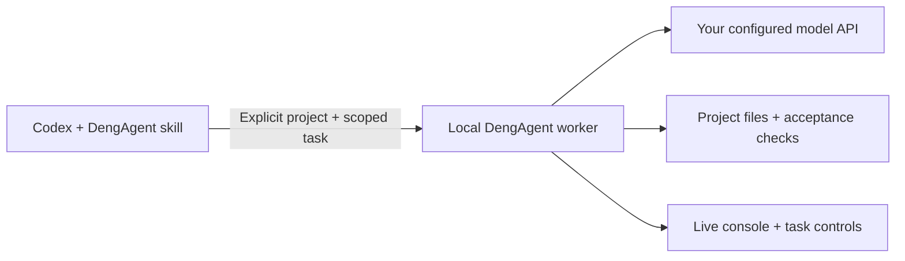
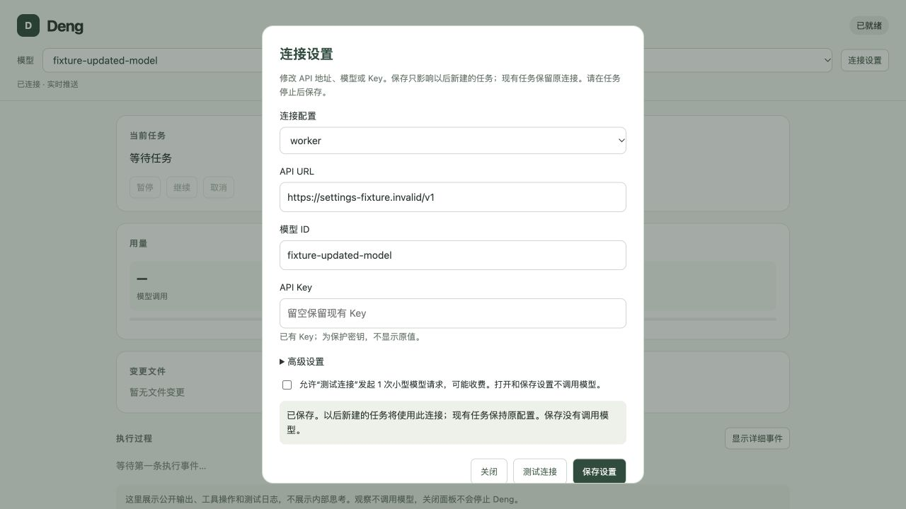
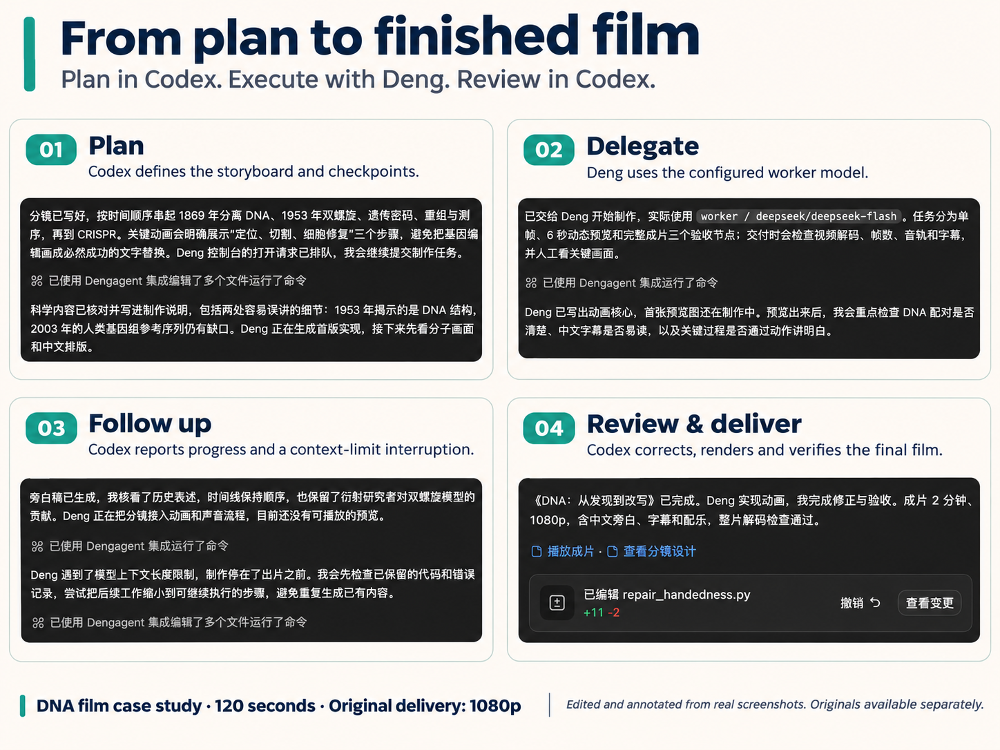

<p align="center"></p>

# DengAgent

**Hand off your plan. Choose your model. Balance capability and cost.**

[Wiki](docs/wiki/Home.md) · Workflow: [EN](docs/workflow.en.md) / [中文](docs/workflow.md) · [简体中文](README.zh-CN.md) · [Examples](docs/showcase.md) · [First task](docs/first-task.md) · [Documentation](docs/README.md) · Release: [EN](docs/announcement.md) / [中文](docs/announcement.zh-CN.md)

When using Codex, you can hand your implementation plan to DengAgent and choose the model that carries it out, balancing capability and cost for each task. Configure its model API, authorize files and commands, and follow execution in a live console. When it finishes, review the file changes, acceptance results and delivery manifest.

Currently supports **Codex integration**. Integrations with other agents are in development. [Integration status](docs/wiki/Integrations.md)

**MIT · Node.js 24+ / npm 10+.** Command isolation has been validated on macOS.

## See the workflow

1. In a Codex project, ask: **“Use DengAgent to implement this feature and run the acceptance checks.”** “Deng” and “DengAgent” select the same worker.
2. Codex reads the skill, selects the explicit project and submits a task through MCP.
3. Follow the work in the console; inspect output, pause, resume or cancel when needed.
4. Review the changed files and fixed acceptance results in your project.

For a small first run, follow [your first task](docs/first-task.md). The separate end-to-end console recording remains [planned](docs/demo-plan.md).



## Why DengAgent

| Capability | What you get |
| --- | --- |
| Choose a model for the task | Configure the worker's API URL, model and Key independently. Select a model for the work and review its actual usage. |
| Keep execution visible | Follow public output, tool activity, changed files, checks and recorded usage in a separate console. Observe or control work without relaying every log through your main chat. |
| Verify the delivered version | Fixed acceptance checks and a SHA-256 file manifest bind the result to a version. Recheck the current workspace with `deng delivery TASK_ID`. |
| Set the working boundary | Authorize files and exact commands; set token/time limits and optionally a call-count cap. Pause, resume or cancel while preserving the original task allowance. |
| Reuse one setup | User-level Codex MCP + skill integration works across local projects. Each call names its project; settings and task records stay local. |

Choose a model for the task and evaluate cost using recorded usage, rework and acceptance results. [Delivery and recovery details](docs/delivery-lifecycle.md)

## Quick start

Install Node.js 24+ and npm 10+. Install from npm, then initialize:

> npm publication is undergoing automated validation. The registry command below becomes usable when the full package is released; the temporary holding package does not contain the CLI.

```sh
npm install --global dengagent
deng init
```

Setup asks for an API **base URL**, model ID and hidden optional Key. It installs user-level Codex MCP and skill integration once, without binding a task workspace. No provider/model is preset. If you skip the Key, add it later with `deng configure`.

Reload Codex MCP and start a fresh chat in a project. Ask Deng to implement a small, concrete change and run its checks. If there is no project context, choose a project first. New projects do not need their own `init`.

Installation and saving settings do not call a model. Submitting a real task uses your provider account. [Installation, upgrades and PATH troubleshooting](docs/npm-installation.md)

<details>
<summary>Already using a project-scoped Deng installation?</summary>

Finish existing work before migration. If its engine is still running, explicitly stop it, then migrate:

```sh
deng stop-engine --project /absolute/old-project
deng init --from-project /absolute/old-project
```

Migration backs up the project connection and shadowing Deng MCP/skill entries, copies existing file credentials into private user storage, and links future defaults to the user connection. It preserves an existing global connection, original credential files and task history. A running engine is refused; tasks are never stopped automatically. Other legacy projects remain overrides until explicitly migrated. [Migration details](docs/global-integration.md)

</details>

[Model generation defaults and reasoning](docs/model-settings.md)

## Configure and control

From any directory:

```sh
deng configure          # edit the user connection; blank Key retains its value
deng configure --show   # public metadata only; does not verify the provider
deng console            # local browser settings console
```

For a project-specific connection, use `deng configure --project /absolute/project`. Global edits affect future tasks in inheriting projects; an explicit project override stays independent. Existing tasks retain their connection snapshots. Opening/saving settings makes zero model calls; the separate connection test requires explicit permission for one small potentially billable request. [Configuration and credentials](docs/configuration.md)

<details>
<summary>Connection settings screenshot — fixture data</summary>



</details>

For direct CLI use, adapt [the task example](examples/implementation.task.json) to files and fixed checks in your project. Run from that project, or pass `--project /absolute/project`:

```sh
deng run --task /absolute/task.json --watch
deng status TASK_ID
deng pause TASK_ID
deng resume TASK_ID
deng cancel TASK_ID
```

The global MCP always requires an absolute `project` argument, independent of its launch directory. Hosts can use `prepare_console` to open the project console; a visible console is not required for authorized backend execution. Fresh console URLs change after engine restarts. CLI `watch` interruption ends observation; `run --watch` interruption requests a pause. [Console and controls](docs/console.md)

## Made with DengAgent

**Full collaboration example: [making a DNA film](docs/workflow.en.md)**

Plan the storyboard in Codex, delegate implementation to Deng, then correct and verify the result in Codex. The case includes an English annotated graphic, translated stage notes, original screenshots and the complete film with English captions.

[](docs/workflow.en.md)

Illustrated guide: [English](docs/media/workflow/dna-walkthrough.en.png) / [中文](docs/media/workflow/dna-walkthrough.zh-CN.png)

**More output examples**

These three local projects show procedural animation, rendering and fixed checks. Click a cover to open the complete MP4; [case notes and verification](docs/showcase.md) explain the methods and check coverage.

[](https://github.com/Steven-Zhu/dengagent/raw/refs/heads/main/docs/media/showcase/tourbillon.mp4)

**Tourbillon · 20 s · 1080p output with sound** — an existing procedural watch project re-rendered and checked through Deng. [Watch MP4](https://github.com/Steven-Zhu/dengagent/raw/refs/heads/main/docs/media/showcase/tourbillon.mp4).

| Pelican on Two Wheels · 12 s | Five Moves to Solve · 18 s |
| --- | --- |
| [](https://github.com/Steven-Zhu/dengagent/raw/refs/heads/main/docs/media/showcase/pelican.mp4) | [](https://github.com/Steven-Zhu/dengagent/raw/refs/heads/main/docs/media/showcase/cube.mp4) |
| Procedural illustration and linked pedal motion. [Watch MP4](https://github.com/Steven-Zhu/dengagent/raw/refs/heads/main/docs/media/showcase/pelican.mp4). | Layer motion, 54 sticker identities and a checked final state. [Watch MP4](https://github.com/Steven-Zhu/dengagent/raw/refs/heads/main/docs/media/showcase/cube.mp4). |

Pelican was implemented and iterated with Deng; the watch and cube examples re-render existing projects. See the [case notes](docs/showcase.md) for methods, provenance and check coverage, and the [illustrated workflow](docs/workflow.en.md) for handoff and acceptance.

## License and acknowledgments

[MIT](LICENSE). Built on [Pi Agent Core / Pi AI](https://github.com/earendil-works/pi), independently MIT-licensed. Dependencies retain their own licenses and notices: [NOTICE](NOTICE), [third-party notices](THIRD_PARTY_NOTICES.md), [package inventory](licenses/dependencies.json), [license rationale](docs/licensing.md). DengAgent is independently maintained; host and provider names do not imply affiliation or endorsement.
