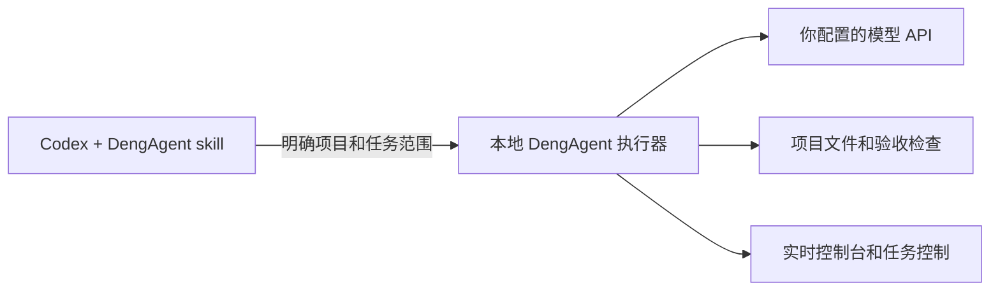
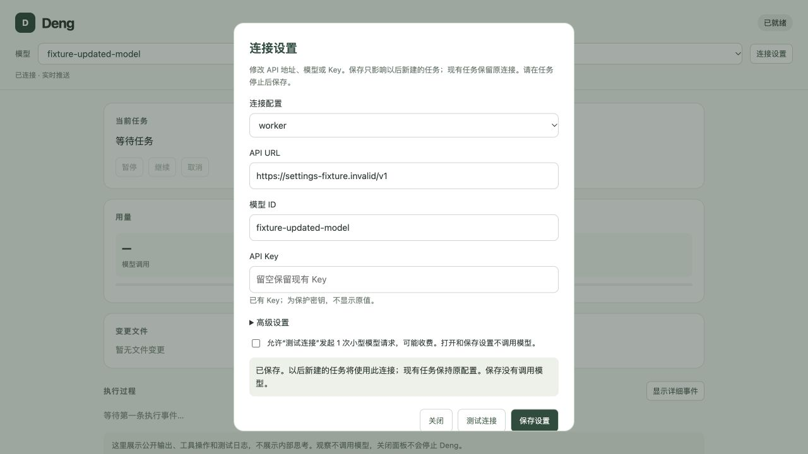
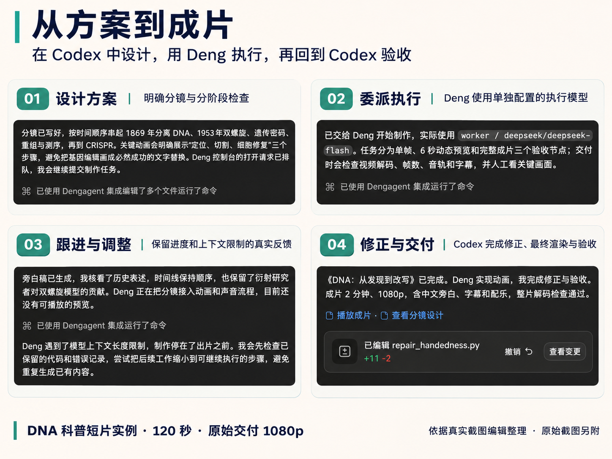

<p align="center"></p>

# DengAgent

**把方案交给 DengAgent，自选模型，平衡智能与成本。**

[Wiki](docs/wiki/Home.md) · 使用过程：[中文](docs/workflow.md) / [EN](docs/workflow.en.md) · [English](README.md) · [视频案例](docs/showcase.md) · [第一次任务](docs/first-task.md) · [文档导航](docs/README.md) · 发布介绍：[中文](docs/announcement.zh-CN.md) / [EN](docs/announcement.md)

使用 Codex 时，你可以把设计好的方案交给 DengAgent 执行，自由选择执行模型，在智能水平与使用成本之间找到适合自己的平衡。配置模型 API、授权文件和命令后，即可在实时控制台查看执行过程，并在完成后检查文件变更、验收结果与交付清单。

目前支持 **Codex 接入**，其他 Agent 的接入正在开发中。[查看接入说明](docs/wiki/Integrations.md)

**MIT · Node.js 24+ / npm 10+。** 命令隔离已在 macOS 验证。

## 使用流程

1. 在 Codex 项目会话里说：**“使用 Deng 开发这个功能，并运行验收检查。”** “Deng” 和 “DengAgent” 指向同一个执行器。
2. Codex 读取 skill，选择明确的项目，通过 MCP 提交有范围约束的任务。
3. 在控制台观察执行过程；需要时查看输出、暂停、继续或取消。
4. 在项目中检查文件变更和固定验收结果。

建议先按[第一次任务](docs/first-task.md) 完成一个小改动。独立的端到端控制台录屏仍按[录制方案](docs/demo-plan.md) 准备。



## 能做什么

| 能力 | 使用体验 |
| --- | --- |
| 为任务选模型 | 独立配置执行器的 API URL、模型与 Key，按任务需要选择模型，查看实际记录的用量。 |
| 看到独立执行过程 | 在控制台查看公开输出、工具操作、文件变更、检查和用量；观察和控制任务时，无需把每条日志转发到主会话。 |
| 核对交付版本 | 固定验收检查与 SHA-256 文件清单绑定交付结果；用 `deng delivery TASK_ID` 再核对当前工作区。 |
| 明确工作边界 | 授权文件与精确命令，设置 token、时长和可选调用次数上限；暂停、继续、取消均保留原任务额度约束。 |
| 一次接入，跨项目使用 | 用户级 Codex MCP + skill 接入，每次明确项目；配置和任务记录保存在本机。 |

你可以按任务难度选择模型，结合实际用量、返工和验收结果评估成本。[交付与恢复机制](docs/delivery-lifecycle.md)

## 快速开始

准备 Node.js 24+ 和 npm 10+。从 npm 安装，再进行初始化：

```sh
npm install --global dengagent
deng init
```

填写 API **基础地址**、模型 ID，以及输入时隐藏的 Key。没有预设供应商或模型。Key 可留空，稍后运行 `deng configure` 补填。初始化只进行一次用户级 Codex MCP 和 skill 接入，不绑定工作项目。

重载 Codex 的 MCP，再在项目里新开会话。先让 Deng 完成一个具体的小改动并执行检查。没有项目上下文时先选择项目，新项目无需重复 `init`。

安装和保存配置不调用模型；提交真实任务会使用你的供应商账户。[安装、升级与入口排查](docs/npm-installation.md)

<details>
<summary>已有旧版按项目配置的 Deng？</summary>

先处理已有工作。如果旧引擎仍运行，明确停止它，再执行迁移：

```sh
deng stop-engine --project /absolute/old-project
deng init --from-project /absolute/old-project
```

迁移会备份项目连接和遮蔽全局接入的 Deng MCP / skill，将存在的文件凭证复制到用户私有存储，并让以后任务继承全局连接。已有全局连接、原凭证文件和任务历史保留。运行中的引擎会被拒绝迁移，不会自动停任务。其他旧项目保留原覆盖，直到明确迁移。[迁移详情](docs/global-integration.md)

</details>

[模型参数、思考模式与默认额度](docs/model-settings.md)

## 修改配置与控制任务

在任意目录运行：

```sh
deng configure          # 修改用户级连接；Key 留空保留原值
deng configure --show   # 仅显示公开元数据，不验证云端连接
deng console            # 本机浏览器连接设置控制台
```

需要项目专用连接时，使用 `deng configure --project /absolute/project`。全局修改影响继承它的项目的新任务，明确的项目覆盖保持独立；已有任务保留原连接快照。打开和保存配置不调用模型，独立的连接测试需要明确允许一次可能收费的小请求。[配置与凭证](docs/configuration.md)

<details>
<summary>连接设置截图：虚构配置示例</summary>



</details>

直接使用 CLI 时，按项目实际文件和固定检查修改[任务示例](examples/implementation.task.json)。在目标项目目录运行，或明确传入 `--project /absolute/project`：

```sh
deng run --task /absolute/task.json --watch
deng status TASK_ID
deng pause TASK_ID
deng resume TASK_ID
deng cancel TASK_ID
```

全局 MCP 的每个调用都要求绝对 `project` 路径，不依赖启动目录。宿主可用 `prepare_console` 打开项目控制台；控制台是否可见不影响已授权的后台执行。引擎重启后需获取新地址。独立 `watch` 中断只结束观察，`run --watch` 中断会请求暂停。[控制台与任务控制](docs/console.md)

## 用 Deng 做出的案例

**完整协作实例：[制作一支 DNA 科普短片](docs/workflow.md)**

先在 Codex 中设计分镜，再交给 Deng 实现，最后回到 Codex 修正与验收。案例页包含编辑图解、真实会话原图、阶段说明和完整成片；英文读者另有完整英文解说与英文字幕版。

[](docs/workflow.md)

图解：[中文](docs/media/workflow/dna-walkthrough.zh-CN.png) / [English](docs/media/workflow/dna-walkthrough.en.png)

**更多视频成品**

以下三个本地项目分别展示程序化动画、渲染和固定验收。点击封面打开完整 MP4；[案例说明与验证范围](docs/showcase.md) 介绍制作方式与检查范围。

[](https://github.com/Steven-Zhu/dengagent/raw/refs/heads/main/docs/media/showcase/tourbillon.mp4)

**陀飞轮 · 20 秒 · 1080p 输出与声音**：已有程序化腕表项目，通过 Deng 重新渲染并验收。[观看 MP4](https://github.com/Steven-Zhu/dengagent/raw/refs/heads/main/docs/media/showcase/tourbillon.mp4)。

| 鹈鹕骑车 · 12 秒 | 五步魔方 · 18 秒 |
| --- | --- |
| [](https://github.com/Steven-Zhu/dengagent/raw/refs/heads/main/docs/media/showcase/pelican.mp4) | [](https://github.com/Steven-Zhu/dengagent/raw/refs/heads/main/docs/media/showcase/cube.mp4) |
| 程序化插画、踏板与腿部联动。[观看 MP4](https://github.com/Steven-Zhu/dengagent/raw/refs/heads/main/docs/media/showcase/pelican.mp4)。 | 分层转动、54 个贴片身份与终态检查。[观看 MP4](https://github.com/Steven-Zhu/dengagent/raw/refs/heads/main/docs/media/showcase/cube.mp4)。 |

鹈鹕由 Deng 实现并迭代；腕表和魔方通过已有项目重新渲染。制作方式、素材来源与检查范围见[案例说明](docs/showcase.md)；交接和验收过程见[工作流截图](docs/workflow.md)。

## 协议与致谢

采用 [MIT](LICENSE)。底层 [Pi Agent Core / Pi AI](https://github.com/earendil-works/pi) 独立采用 MIT，第三方组件保留各自的协议和声明，详见 [NOTICE](NOTICE)、[第三方声明](THIRD_PARTY_NOTICES.md)、[依赖清单](licenses/dependencies.json)与[协议选择说明](docs/licensing.md)。DengAgent 独立维护，提及宿主或供应商不代表关联或背书。
