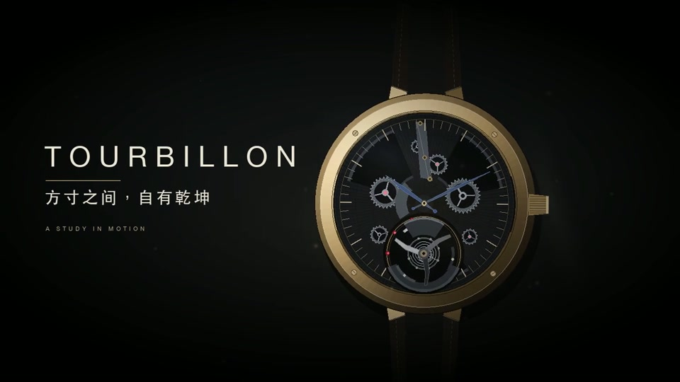

# DengAgent：让编程助手多一个可观察、可验收的本地执行器

[English](announcement.md) · [仓库首页](../README.zh-CN.md) · [三个视频案例](showcase.md) · [第一次任务](first-task.md)

使用 Codex 时，你可以把设计好的方案交给 DengAgent 执行，自由选择执行模型，在智能水平与使用成本之间找到适合自己的平衡。配置模型 API、授权文件和命令后，即可在实时控制台查看执行过程，并在完成后检查文件变更、验收结果与交付清单。

目前支持 Codex 接入，其他 Agent 的接入正在开发中。[接入说明](wiki/Integrations.md)

**把任务交出去，把过程和交付留在眼前。**

## 从一句话开始

在已接入的 Codex 项目里说：

> 使用 Deng 开发这个功能，先明确允许修改的文件和固定验收检查，再提交任务。

Codex 通过 MCP 把目标、文件范围、允许执行的命令和验收要求交给 Deng。Deng 读取文件、编写代码、运行授权命令，在控制台展示公开输出、工具活动、文件变更、检查和用量。你可以暂停、追加同范围说明、继续或取消任务。

完成后，检查实际产物与固定验收结果。交付记录还保存文件的 SHA-256 清单，可以再核对当前工作区与当时交付的版本是否一致。

## 为什么值得试

**为执行选择合适的模型。** 执行器使用你自己的 API 地址、模型和 Key，可以与主助手使用不同的模型。你可以根据任务选择连接，并用实际用量评估开销。产品不预设供应商，也不承诺未经对照实验的降本比例。

**把连续执行放进独立任务。** 主助手负责界定范围和审查结果，Deng 负责授权范围内的执行；控制台承接公开过程和日志，MCP 提供简洁的任务状态与交付信息。适合目标明确的功能改动、脚本、批量文件工作和程序化内容制作。

**让“完成”有可以检查的依据。** 固定检查、显式保护的检查文件和产物摘要共同记录交付版本。后续修改导致摘要变化时，可以重新识别。检查质量仍取决于你定义的验收条件，艺术效果和业务语义需要相应评审。

**给长任务保留控制权。** 文件、命令、token 和时长有明确范围；关闭控制台不取消执行。暂停与恢复保留原任务额度、用量和期限，未确认的模型用量或命令副作用有单独的恢复确认路径。

**配置一次，用到不同本地项目。** 用户级 Codex MCP 与 skill 接入复用，每次调用明确项目。设置、凭证和任务记录保存在本机；模型请求发送到所选供应商。

完整的设计、交接和审查过程见 [DNA 图解实例](workflow.md)，另有[英文案例](workflow.en.md)与英文字幕成片。

## 开始试用

项目采用 **MIT 协议**。需要 Node.js 24+、npm 10+；命令隔离主要在 macOS 验证。按[安装指南](npm-installation.md) 从 npm 安装，然后执行：

> npm 发布正在自动校验中。完整安装包上线后再使用下方注册表安装命令；临时占位包不包含 CLI。

```sh
npm install --global dengagent
deng init
```

配置 API 基础地址、模型和 Key，重载 Codex MCP，再在项目会话中提交一个具体小任务。[第一次任务](first-task.md) 同时提供无需模型请求的源码离线演示入口。

既有本地验证包含回归测试，以及三个项目的真实供应商任务与视频检查；离线回归与真实项目的验证范围分别记录在[验证说明](verification.md)。这些记录不能代替新环境验证。实际构建与验证记录随发布说明提供。

适合先用一个可检查的小改动体验完整闭环，再逐步扩大任务。我们希望从真实试用中了解：哪些任务值得委派、哪里需要更清楚的过程、怎样的验收最能帮助审查。

## 看三个实际成品

[](https://github.com/Steven-Zhu/dengagent/raw/refs/heads/main/docs/media/showcase/tourbillon.mp4)

**陀飞轮：20 秒程序化概念短片。** 已有腕表项目经 Deng 重新渲染、导出并检查视频和音频。成片输出 1920×1080、24 fps，带本地合成声音。画面在 1280×720 设计空间生成后上采样，表现为 2.5D 插画。它展示了带前置素材和固定检查的渲染交付流程。[观看完整视频](https://github.com/Steven-Zhu/dengagent/raw/refs/heads/main/docs/media/showcase/tourbillon.mp4)。

**鹈鹕骑车：12 秒插画动画。** Deng 实现并迭代 Python 绘制脚本，生成角色、自行车、海岸背景与联动动作，再编码成 720p、30 fps 视频。角色和场景由代码绘制。[观看完整视频](https://github.com/Steven-Zhu/dengagent/raw/refs/heads/main/docs/media/showcase/pelican.mp4)。

**五步魔方：18 秒状态驱动动画。** 已有项目通过 Deng 重新渲染；54 个贴片保留身份与状态，按 R、U、F、L、D 五步转动，并检查六面复原。初态为专门构造的可五步复原状态。[观看完整视频](https://github.com/Steven-Zhu/dengagent/raw/refs/heads/main/docs/media/showcase/cube.mp4)。

这三条是成品示例，不是连续工作流录屏，也不组成模型优劣或成本对比实验。[案例页](showcase.md) 记录原始任务检查、传播版处理方式和已知边界。
