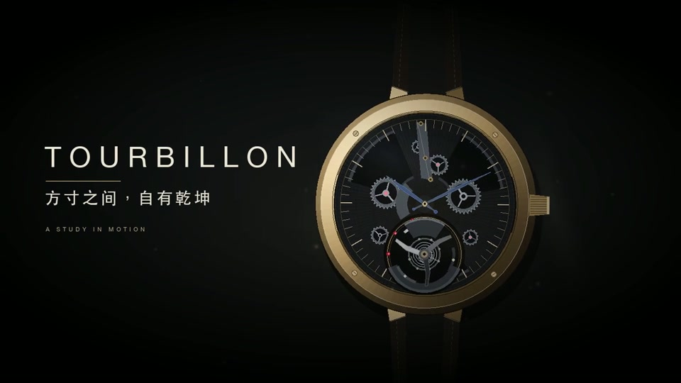
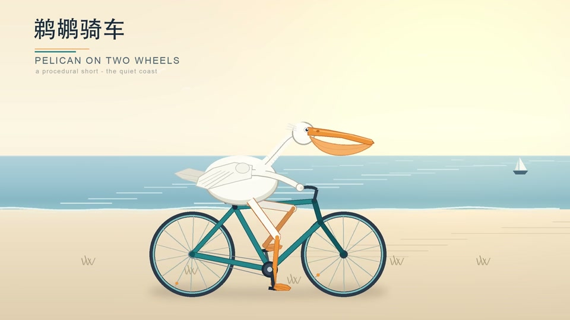

# Made with DengAgent / 视频案例

[English overview](../README.md) · [中文首页](../README.zh-CN.md) · [Try your first task / 第一次任务](first-task.md)

Three local projects demonstrate different parts of scoped execution: implementing a procedural animation, rendering an existing project and checking a state-driven result. All three had a real-provider run through the installed runtime. The main assistant scoped work and inspected evidence; the authorized Deng command path performed the final renders.

三个本地项目对应不同任务：实现程序化动画、渲染已有工程、检查状态驱动的结果。三项均通过已安装的执行器 执行过真实供应商任务；主助手定义范围并检查证据，最终渲染由 Deng 的授权命令执行。

## Tourbillon / 陀飞轮

**[Watch the complete 20-second MP4 / 观看完整 20 秒视频](https://github.com/Steven-Zhu/dengagent/raw/refs/heads/main/docs/media/showcase/tourbillon.mp4)**

| Item / 项目 | Evidence / 内容 |
| --- | --- |
| Task / 任务 | Re-render an existing procedural watch project with its fixed reference engine and checks. / 使用已有绘制引擎和固定检查重新渲染腕表项目。 |
| Output / 成片 | 1920×1080, 24 fps, 480 frames; H.264 video and 48 kHz stereo AAC. / 20 秒，H.264 视频与 48 kHz 双声道 AAC。 |
| Workflow / 流程 | Preview, short draft, final render and independent format/integrity verification. / 预览、短草稿、正式渲染与独立格式和完整性检查。 |
| What it shows / 展示能力 | Work within existing project inputs, run a longer rendering command, deliver several required files and check audio/video. / 围绕既有输入执行渲染，交付多个必需文件并检查音视频。 |
| Boundary / 边界 | 2.5D procedural concept artwork, rendered at 1280×720 and upscaled to 1080p. Motion is illustrative; no physical movement accuracy is certified. / 程序化概念插画，720p 绘制后上采样；运动用于视觉表达。 |

The publication copy retains the original dimensions, frame count, sequence and audio content, with distribution encoding. The original accepted file and this copy have different hashes.

传播版保留原尺寸、帧数、镜头顺序和声音内容，重新编码以便分发；其文件摘要与原始验收文件不同。

## Pelican on Two Wheels / 鹈鹕骑车

**[Watch the complete 12-second MP4 / 观看完整 12 秒视频](https://github.com/Steven-Zhu/dengagent/raw/refs/heads/main/docs/media/showcase/pelican.mp4)**

| Item / 项目 | Evidence / 内容 |
| --- | --- |
| Task / 任务 | Implement and iterate a procedural animation with Python, Pillow and NumPy. / 用 Python、Pillow 与 NumPy 实现并迭代动画。 |
| Output / 成片 | 1280×720, 30 fps, 360 frames; H.264, no audio. / 12 秒 H.264 视频，无音轨。 |
| Motion / 动作 | Pedal-linked feet, articulated legs, body motion and a layered coast scene. / 脚与踏板联动、腿部关节运动、身体起伏和分层海岸场景。 |
| Checks / 检查 | Preview/short/final stages, full decode, motion checks and frames extracted from the encoded result. / 预览、短片、正片分阶段检查，完整解码、运动检测与成片抽帧。 |
| What it shows / 展示能力 | Translate a visual brief into local drawing code and inspect the actual encoded output. / 将画面要求转成绘制代码，并核对实际编码的结果。 |

All shapes and motion are generated by the project code; no external illustration assets were used. The distributed video is remuxed with the encoded picture content retained.

场景、角色与运动由工程代码生成，未使用外部插画素材。传播版重新封装，保留原编码画面。

## Five Moves to Solve / 五步魔方

**[Watch the complete 18-second MP4 / 观看完整 18 秒视频](https://github.com/Steven-Zhu/dengagent/raw/refs/heads/main/docs/media/showcase/cube.mp4)**

| Item / 项目 | Evidence / 内容 |
| --- | --- |
| Task / 任务 | Re-render and verify an existing state-driven cube animation. / 重新渲染并验证已有状态驱动魔方工程。 |
| Output / 成片 | 1280×720, 30 fps, 540 frames; H.264 with synthesized sound. / 18 秒 H.264 视频，含合成声音。 |
| State / 状态 | 54 stable sticker identities; initial state constructed using D′ L′ F′ U′ R′, then solved by R U F L D. / 54 个稳定贴片身份，初态按逆序构造，再经五步复原。 |
| Checks / 检查 | State snapshots for each step, solved six-face final state, full decode and turning/final frame inspection. / 逐步状态快照、六面复原、完整解码，以及转层和片尾抽帧。 |
| What it shows / 展示能力 | Pair a visual result with deterministic checks of its underlying state. / 同时验收画面与底层状态。 |
| Boundary / 边界 | A deliberately prepared five-move case; no arbitrary-state solver is included. / 特制初态的五步案例，未包含任意状态求解器。 |

The publication copy retains the original encoded video and audio content in a refreshed MP4 container.

传播版重新封装为 MP4，保留原编码音视频内容。

## What was verified / 验证范围

The original project records report passing fixed acceptance checks and valid delivery manifests. Final output was inspected with selected decoded frames. This gallery includes portable [media provenance and hashes](media/showcase/manifest.json) and a [sanitized evidence summary](media/showcase/verification.json); original private task databases and logs are excluded.

原项目记录包含固定验收通过、交付清单复核有效，以及成片抽帧检查。这里附上可公开的[素材来源与摘要](media/showcase/manifest.json)和[验证摘要](media/showcase/verification.json)，不分发原始私有任务数据库与日志。

The recorded worker model ID for the three regression runs is `deepseek/deepseek-flash`. This identifies the configured route used in those runs, not a certification of every route bearing a similar name. No main-assistant-versus-worker cost comparison is claimed.

三项回归记录中的执行模型 ID 为 `deepseek/deepseek-flash`，对应当时配置的实际连接，不代表所有同名转发路线均已验证。主助手工作与执行器工作的范围不同，不能直接比较 token 总数来声称节省比例。

For publication, all three MP4 copies were separately probed and completely decoded for video and any audio. Their original acceptance records refer to the original hashes, not to the transformed web copies. Selected frames and format/state checks do not constitute comprehensive artistic or business-quality certification.

三份传播版均重新探测格式并完整解码视频及存在的音轨。原任务验收对应原文件摘要；传播版检查单独记录。抽帧与格式、状态检查不等于全面的美术或业务质量认证。

These examples show outputs. The [end-to-end console walkthrough](demo-plan.md) remains a separate recording task. The complete original rendering projects are not bundled here; use the [small first-task guide](first-task.md) to try the worker.

这些视频展示产物，独立的[端到端控制台录屏](demo-plan.md) 仍待录制。完整原渲染工程未随案例页打包；首次体验请使用[小任务指南](first-task.md)。

## 完整协作案例 / Full collaboration case

[DNA 科普短片实例](workflow.md) 展示用户提供的 Codex 原生会话截图：方案与交接、进度跟进、中途限制，以及 Codex 的最终修正与验收。该项目与上面三个图库案例分别记录。

See the [English DNA film case](workflow.en.md) for native Codex screenshots, the real division of work and the complete result.
