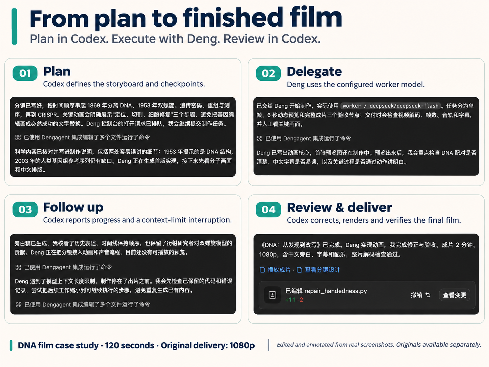
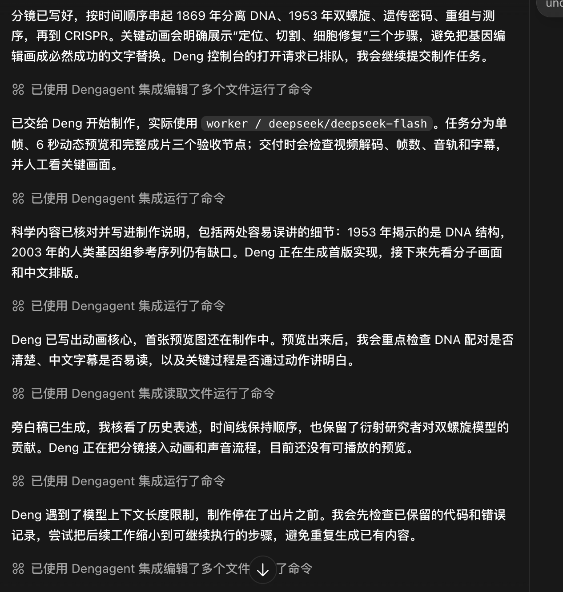
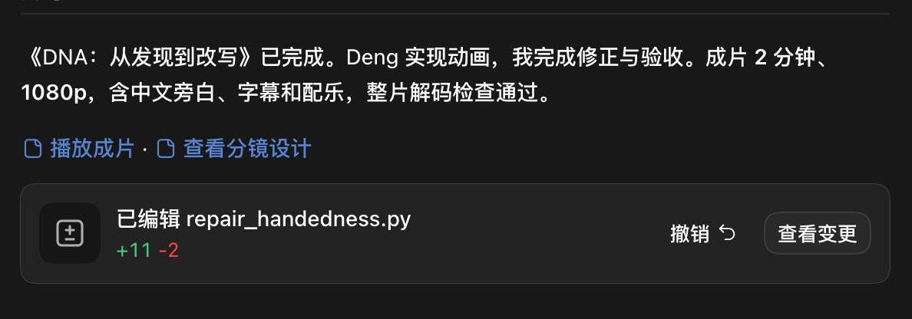

# Case study: making a DNA film with Codex and Deng

[简体中文](workflow.md) · [English overview](../README.md) · [Wiki](wiki/Home.md) · [First task](first-task.md)

**Plan in Codex. Execute with Deng. Review in Codex.**

This case follows a two-minute educational film about DNA. Codex defined the storyboard and review criteria, delegated animation and sound implementation to Deng, followed progress, and completed corrections, final rendering and acceptance.

*Edited explanatory graphic based on two real conversation screenshots. English headings explain the Chinese source conversation. This is a composed walkthrough, not a continuous recording or an English-language UI capture. [Original screenshots](#original-screenshots) remain available below.*

## 1. Define the plan in Codex

The brief called for a film with a chronological story, procedural animation, Mandarin narration, subtitles and music. Codex outlined the scenes and specified three checkpoints: a still frame, a six-second preview and the complete film.

It also identified what to review: whether the molecular scenes communicated the intended process, whether Chinese text remained readable, and whether the encoded video, frame count, audio and subtitles met the delivery requirements.

The source conversation says, in summary: the storyboard is ready; the important animation should show locating, cutting and cell repair as distinct steps. Codex then prepares to submit the production task.

## 2. Hand implementation to Deng

Codex confirmed the handoff and reported the actual configured worker as `worker / deepseek/deepseek-flash`. Deng used that separate model connection to implement animation and sound code.

The native conversation shows both integration-tool activity and the main assistant's progress updates. Those updates summarize task information; they are not Deng tokens streamed directly into the native assistant message.

The practical benefit is a clear division of work: choose the worker model for implementation, while keeping the plan and review with Codex. This case does not measure a savings percentage or compare model performance.

## 3. Follow progress and respond to interruptions

Codex reported that the animation core and narration were being prepared and described the checks it intended to make on previews.

The source screenshot also preserves a context-limit interruption before the film was finished. Codex stated that it would inspect retained code and error records, then narrow the remaining work into smaller executable steps. The graphic keeps this event visible because it is part of the actual workflow.

## 4. Correct and verify the result in Codex

The final screenshot records a completed film and an implementation correction. Its summary attributes animation implementation to Deng and correction and acceptance to Codex. The project's delivery notes also record final rendering by Codex.

| Responsibility | What happened in this project |
| --- | --- |
| Codex | Narrative and storyboard, factual review, progress follow-up, corrections, final rendering and acceptance |
| Deng | Animation and sound implementation using the configured worker model |
| Original delivery | 120 seconds, 1920×1080, 30 fps, narration, subtitles and music |

This was a supervised collaboration with corrections before delivery. The source material does not establish that Deng independently completed every production step.

## Watch with English captions

**[Watch the complete film with English captions](https://github.com/Steven-Zhu/dengagent/raw/refs/heads/main/docs/media/workflow/dna-history.en.mp4)**

The distribution video is 1280×720 with added English captions. It retains the Mandarin narration and original Chinese picture text. The original delivered film is 1080p. You can also download the [English SRT](media/workflow/dna-history.en.srt) or [English WebVTT](media/workflow/dna-history.en.vtt), or open the [original-language distribution copy](https://github.com/Steven-Zhu/dengagent/raw/refs/heads/main/docs/media/workflow/dna-history.mp4).

The English cues retain the original subtitle timing. [Media provenance and validation](media/workflow/dna-media.json) distinguish the original delivery from these publication copies.

## Original screenshots

Open the unchanged Chinese source conversation and completion screenshot

The first image covers the planning, handoff and progress stages. The second records completion and a correction made in Codex. Neither is a recording of the whole session. [Screenshot provenance](media/workflow/codex-screenshots.json).

For additional tool and command events, the [Chinese case page](workflow.md) includes a separate historical pelican-console example. That material belongs to a different project.

The [illustration record](media/workflow/illustrations.json) describes the edited graphics and their prompts. Currently supports Codex integration; integrations with other agents are in development.
