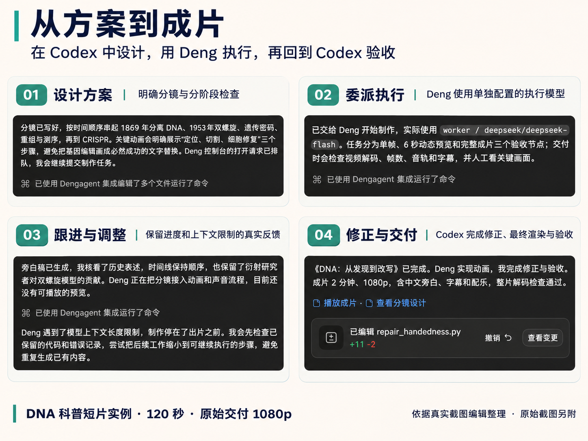
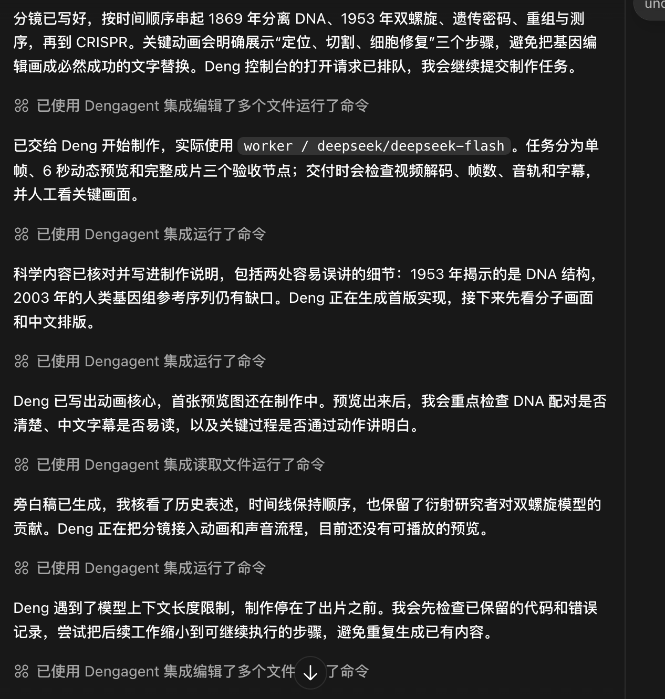
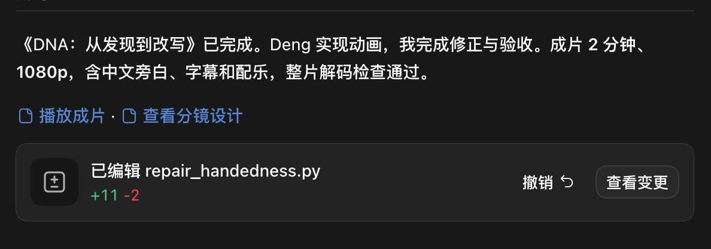
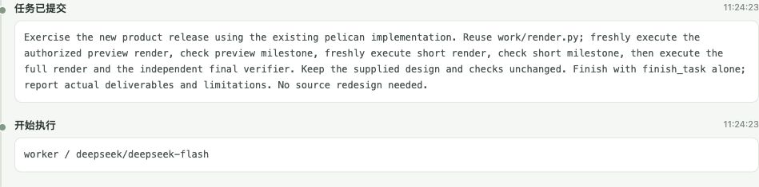
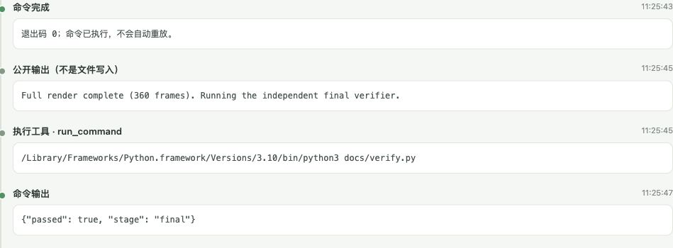
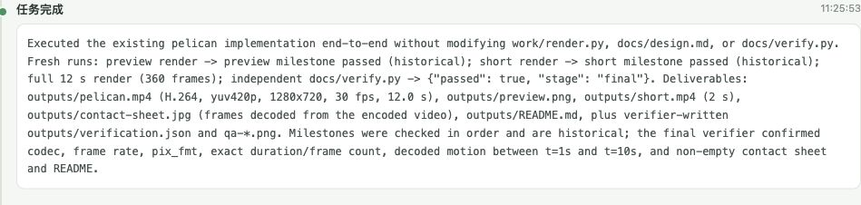

# 实例：在 Codex 中设计一支 DNA 科普短片

[English](workflow.en.md) · [Wiki](wiki/Home.md) · [接入状态 / Integrations](wiki/Integrations.md) · [中文首页](../README.zh-CN.md) · [English overview](../README.md)

**Codex 设计和审查，Deng 执行实现，最后回到 Codex 修正与验收。**

*依据真实截图编辑的解说图，含阶段标注和重点放大。它不是连续录屏；下方保留两张原始截图供对照。[English illustrated case](workflow.en.md)。*

《DNA：从发现到改写》是一支两分钟的中文科普短片。这个实例展示：如何先明确叙事、画面与检查要求，再把实现交给自选模型，并在执行过程中持续审查，直到交付成片。

This two-minute DNA film illustrates the collaboration: plan in Codex, delegate implementation to Deng, follow progress, then correct and verify the result in Codex. Currently supports Codex integration; other agent integrations are in development.

## 先明确要做什么

Codex 先整理按时间展开的分镜，并明确关键动画应该如何表达。任务还拆成单帧、6 秒动态预览与完整成片三个检查节点。

| 设计项 | 本项目的要求 |
| --- | --- |
| 成品 | 两分钟科普短片，含中文旁白、字幕与配乐 |
| 叙事 | 按时间顺序串起 DNA 发现、结构、读取、重组与编辑 |
| 画面 | 关键过程通过动作解释，并检查分子画面和中文排版 |
| 阶段 | 单帧 → 6 秒动态预览 → 完整成片 |
| 验收 | 视频解码、帧数、音轨与字幕检查，再人工看关键画面 |

方案明确后，Codex 把实现交给 Deng。截图中记录的执行连接为 `worker / deepseek/deepseek-flash`，对应本项目使用的模型配置。

## 交给 Deng 后，Codex 会显示什么

下面是用户提供的真实 Codex 会话截图。可以看到方案说明、交接确认、Deng 集成工具调用，以及主助手在执行过程中的进度说明。

展开原始会话：设计、交接和进度

沿着截图往下看，有三个关键变化：

1. **方案进入执行。** Codex 确认已经交给 Deng，说明实际模型和三个检查节点。
2. **主助手持续跟进。** 会话显示工具活动与进度说明，例如动画核心、旁白和画面检查的进展；这些说明由主助手根据任务信息整理。
3. **遇到限制时明确反馈。** 截图保留了模型上下文长度限制导致制作暂停的记录，以及检查已有代码、缩小后续步骤的处理方向。

这张图同时显示了推进和中途阻塞。它记录实际交接与反馈过程，最终完成情况见下一张图。

The native Codex screenshot shows the design, handoff, integration-tool activity and progress updates. It also retains the intermediate context-limit interruption. The assistant's updates summarize task information; they are not a direct token stream from Deng.

## 回到 Codex 修正和验收

最终完成摘要说明了分工：**Deng 实现动画，Codex 完成修正与验收**。图中还保留了修正文件的变更卡片，可以看到主助手参与了收尾。

展开原始完成摘要与修正记录

| 角色 | 本次项目中承担的工作 |
| --- | --- |
| Codex | 叙事与分镜、资料核对、进度跟进、问题修正、最终渲染与验收 |
| Deng | 实现动画与声音程序，推进被委派的制作工作 |
| 交付结果 | 原始成片 120 秒、1920×1080、30 fps，含中文旁白、字幕和配乐 |

最终渲染与验收由 Codex 完成。这是一次包含审查和修正的协作案例，不能把它描述成 Deng 独立完成了全部制作。

The completion screenshot records the final result and a correction made in Codex. Project delivery notes attribute animation/sound implementation to Deng and the narrative, corrections, final rendering and acceptance to Codex. No comparative cost or speed benchmark is implied.

## 看成片

**[观看完整两分钟传播版 MP4](https://github.com/Steven-Zhu/dengagent/raw/refs/heads/main/docs/media/workflow/dna-history.mp4)** · [英文字幕版](https://github.com/Steven-Zhu/dengagent/raw/refs/heads/main/docs/media/workflow/dna-history.en.mp4)

传播版根据最终成片制作，缩小为 1280×720 以便在线分发；原始交付为 1920×1080。视频时长与内容保持完整，原片与传播版摘要、格式和解码检查见[媒体记录](media/workflow/dna-media.json)。

The complete distribution copy is 720p; the original delivered film is 1080p. See the [media record](media/workflow/dna-media.json) for provenance and checks.

## 控制台补充：查看独立执行过程

Codex 会话适合查看方案、交接和审查结论；Deng 控制台适合查看具体工具与命令事件。以下是另一个项目——鹈鹕骑车——的历史控制台记录，与上面的 DNA 会话分别展示。

展开真实鹈鹕任务的交接、检查与完成截图

这些图片来自同一鹈鹕任务的真实历史记录，只做裁切。它们展示已有工程的重新执行，不是 DNA 项目的连续录屏。[观看鹈鹕成片](https://github.com/Steven-Zhu/dengagent/raw/refs/heads/main/docs/media/showcase/pelican.mp4)。

## 截图来源

DNA 两张原图由用户提供，保持原文件与画面文字不变；页首中英文图解采用 imagegen 辅助编辑排版，阶段标题和解说属于编辑标注，详见[图解记录与提示词](media/workflow/illustrations.json)。原图来源与摘要记录在[截图清单](media/workflow/codex-screenshots.json)。它们是两个真实会话画面，没有补画运行状态或拼成连续录屏。另一张含控制台完整地址的鹈鹕分屏图保留在本地参考文件中，未放入公开素材。

The two source DNA images are unchanged user-supplied native Codex screenshots. The lead graphic is an edited explanatory composition; an [English case page](workflow.en.md) provides full English explanations and an English-captioned film. The supplemental console captures belong to a separate historical pelican task. A continuous walkthrough video remains a future recording; these images already document the real native-chat experience.
